<picture>
  <source media="(prefers-color-scheme: dark)" srcset="assets/banner-dark.svg">
  <source media="(prefers-color-scheme: light)" srcset="assets/banner-light.svg">
  
</picture>

 

Inference and training run on a deep stack: GPUs and drivers, storage,
networking, schedulers, runtimes. Much of the cost hides in the seams between
those layers: slow starts, slow data paths, fragile operations.

Tensor Rails builds open-source tools and services for those seams. Each
project takes on one problem, works with the stack you already run, and is
measured on real hardware.

### Projects

| Project | Area | What it does | Status |
|---|---|---|---|
| **[warmctl](https://warmctl.io)** | Runtime | Snapshots a warmed-up vLLM engine and restores it on any matching GPU host in seconds instead of minutes. | beta |

### What we work on

- **Runtime**: starting, restoring and scaling GPU workloads quickly.
- **Storage and data**: fast paths for weights, checkpoints, datasets and caches.
- **Distribution**: moving models and artifacts between hosts, regions and clouds.
- **Operations**: diagnostics, health checks and day-2 tooling for GPU fleets.

### How we work

- Open source first. Services are built on the same open tools.
- Standard interfaces: OCI, Kubernetes, stock drivers and engines.
- Numbers come from runs on real hardware, with the GPUs and versions stated.

---

Tensor Rails is at an early stage and works quietly. More projects are coming;
each is released once it is measured and documented.

Maintained by [Kirill Bespalov](https://www.linkedin.com/in/kirill-bespalov/).
